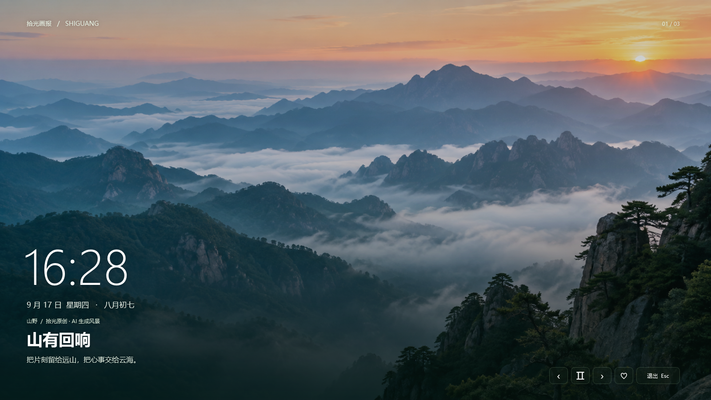

# 拾光画报

一个受早期 WPS 画报体验启发的 Windows 原生屏保：大幅风景、简洁时钟、轻柔轮播，以及自己的照片和收藏。

## 新手安装

适用于 **Windows 10 / 11**。如果提示缺少 .NET Framework，请先安装微软的 [.NET Framework 4.8 运行时（Runtime）](https://dotnet.microsoft.com/en-us/download/dotnet-framework/net48)；已安装 4.8 或 4.8.1 可跳过。

### 方式一：从 GitHub 下载压缩包

- **成品包**：如果仓库的 **Releases → Assets** 中提供了 `ShiguangPoster-*-win.zip`，下载后右键选择 **全部解压**，再双击解压目录里的 `ShiguangPoster.exe`。
- **源码包**：通过 **Code → Download ZIP** 或 **Source code (zip)** 下载后，先全部解压，打开含有 `build.ps1` 的文件夹，在资源管理器地址栏输入 `powershell` 并回车，执行：

```powershell
powershell.exe -NoProfile -ExecutionPolicy Bypass -File .\build.ps1
```

编译完成后，双击 `dist\ShiguangPoster\ShiguangPoster.exe`。

### 方式二：克隆源码

先安装 [Git for Windows](https://git-scm.com/install/windows)。在仓库页面点击 **Code → HTTPS** 复制地址，然后打开 PowerShell，将下面第一行的中文替换为该地址，依次执行：

```powershell
git clone "这里替换为仓库的HTTPS地址" ShiguangPoster
cd .\ShiguangPoster
powershell.exe -NoProfile -ExecutionPolicy Bypass -File .\build.ps1
.\dist\ShiguangPoster\ShiguangPoster.exe
```

**启用自动屏保**：打开软件后，进入 **屏保设置**，选择空闲时间，点击 **启用系统屏保**。默认按 **Esc** 退出，也可在设置中改为点击空白位置退出。

## 项目预览

可运行版本：`dist/ShiguangPoster/ShiguangPoster.exe`。使用 .NET Framework 4.8 编译，**未安装任何运行环境或第三方依赖**。



## 开始使用

1. 双击 `ShiguangPoster.exe` 打开主界面。
2. 点击 **预览屏保**，或在画报上点击 **沉浸欣赏**。
3. 需要自动屏保时，进入 **屏保设置**，选择空闲分钟数，点击 **启用系统屏保**。
4. 需要播放自己的照片时，进入 **我的相册 → 添加照片文件夹**。

启用后可以关闭主窗口，Windows 仍会在空闲时启动屏保。启用操作将屏保文件复制到当前用户的数据目录，移动或删除下载的便携目录不会使已启用的屏保失效。

首次打开不会自动启用系统屏保。停用时点击 **停用拾光屏保**，程序会恢复启用前保存的屏保路径、启用状态和等待时间。如果你随后已经在 Windows 中改用了其他屏保，停用拾光不会覆盖那个选择。

已启用旧版系统屏保时，请在新版程序的 **屏保设置** 中点击一次 **更新系统屏保**，同步已安装的屏保副本。

恢复时是否显示登录屏幕，由 Windows 的屏保设置管理；软件内提供了对应入口。

## 已实现

- **画报精选**：三张内置 AI 风景、山野/海岸/旷野分类、实时时钟预览。
- **本地相册**：读取 JPG、JPEG、PNG、BMP、TIF、TIFF，可包含子文件夹；支持手机照片的 EXIF 旋转和镜像方向。
- **收藏**：画报爱心收藏，可设置只播放收藏。
- **屏保播放**：顺序或随机轮播、淡入淡出、暂停、前后切换、亮度调整。
- **退出方式**：在 **屏保设置 → 播放的节奏 → 退出屏保方式** 中，选择 **按退出键（Esc）退出** 或 **鼠标点击屏保空白位置退出**。设置自动保存，对下一次全屏预览和自动屏保生效；旧配置默认使用 Esc 模式。
- **时钟日期**：12/24 小时制、公历、星期、农历、左下或居中布局、心情短句开关。
- **多显示器**：全部屏幕同步显示同一张画报，也可只显示主屏；显示器配置变化时退出屏保。
- **每日壁纸**：默认关闭；打开后从必应下载最近八天的图片，缓存最多三十张。打开主程序或运行系统屏保时检查当日更新；断网时继续使用已有图片。
- **Windows 原生屏保**：随包提供 `.scr`，支持 `/s` 运行、`/c` 设置、`/p HWND` 系统缩略预览。
- **本地保存**：设置自动保存；损坏设置会备份后回退，无法读取的图片会跳过。

当前相册最多载入 1500 张图片、50 个文件夹；画廊分页显示。移除相册只移除目录引用，原图保留在原处。所选播放来源或收藏为空时，会使用内置画报。

必应接口和图片由第三方提供，可能受网络或服务变动影响。在线画报显示其来源说明；内置图片明确标记为 AI 生成风景。

## 快捷键

| 场景 | 按键 | 操作 |
| --- | --- | --- |
| 主界面 | F5 | 开始全屏预览 |
| 全屏预览 | ← / → | 上一张 / 下一张 |
| 全屏预览 | 空格 | 暂停 / 继续 |
| 全屏预览 | F | 收藏 / 取消收藏 |
| Esc 退出模式（预览 / 自动屏保） | Esc | 退出；预览时返回主界面 |
| 空白点击模式（预览 / 自动屏保） | 鼠标左键点击空白位置 | 退出；预览时返回主界面 |

全屏预览的操作按钮在鼠标静止五秒后自动隐藏，移动鼠标重新显示。

两种模式下，移动鼠标和其他普通按键都不会退出屏保。空白点击模式下，Esc 也不会退出；图片、日期、文字等非操作区域都可以点击退出。点击切图、暂停或收藏按钮，以及从按钮拖到背景后松开鼠标，都不会触发空白退出。Esc 模式的全屏预览也保留屏幕上的“退出”按钮。

## 文件与数据

便携包包含：

```text
ShiguangPoster/
  ShiguangPoster.exe
  ShiguangPoster.exe.config
  ShiguangPoster.scr
  ShiguangPoster.scr.config
  README.md
  docs/
```

三张风景图和界面资源均嵌入程序，不需要额外复制图片目录。

用户数据默认位于 `%LOCALAPPDATA%\ShiguangPoster`：

| 位置 | 用途 |
| --- | --- |
| `settings.json` | 屏保偏好、本地相册路径、收藏列表 |
| `cache/`、`bing.json` | 必应图片及来源缓存 |
| `bin/ShiguangPoster.scr` | 点击启用后保存的系统屏保副本 |
| `previous-screensaver.json` | 启用前的 Windows 屏保设置备份 |
| `app.log` | 启动、读取或网络错误日志 |

本地照片只在本机读取。默认不联网；只有开启每日壁纸后才连接必应。运行不需要管理员权限；电脑上的组织策略可能限制 Windows 屏保设置。

## 构建与验证

目标为 Windows 10/11、.NET Framework 4.8。使用 Windows 已有的 Framework C# 编译器及 WPF，无 NuGet、Node.js 或 Python 依赖。

在项目目录运行：

```powershell
powershell.exe -NoProfile -ExecutionPolicy Bypass -File .\build.ps1 -Verify
```

这里的 `ExecutionPolicy Bypass` 只作用于这一次构建进程，不会修改系统或用户的执行策略。脚本找不到编译器时会报错，不会自动下载或安装环境。

增加 `-Package` 参数可同时生成 `dist/ShiguangPoster-1.0.0-win.zip` 便携包。

命令行示例：

```powershell
.\dist\ShiguangPoster\ShiguangPoster.exe --preview
.\dist\ShiguangPoster\ShiguangPoster.scr /s
.\dist\ShiguangPoster\ShiguangPoster.scr /c
```

`--data-dir <目录>` 可将数据隔离在指定目录；测试使用这一选项，不接触正式用户配置。`--verify` 执行离屏检查并生成截图；`--check-online` 验证实际图片下载；`--smoke-test` 短暂打开原生窗口和全屏测试，结束后自动关闭。这些测试不会执行系统屏保启用/停用操作。

验证覆盖设置读写与损坏恢复、旧退出设置迁移、参数解析、相册读取去重、图片解码与 EXIF 方向、随机轮播、收藏筛选、农历日期、界面渲染，以及原生预览、切图、暂停、两种退出方式和按钮误触防护。实际的空闲触发与恢复登录行为，需要用户启用后由当前 Windows 设置决定。

项目结构：`src/` 源代码，`assets/` 内置图片，`build.ps1` 构建脚本，`artifacts/` 验证产物，`dist/` 便携成品。

内置图片的生成方式、文件路径和完整提示词见 [素材说明](docs/ASSETS.md)。实现与测试详情见 [开发说明](docs/DEVELOPMENT.md)。
